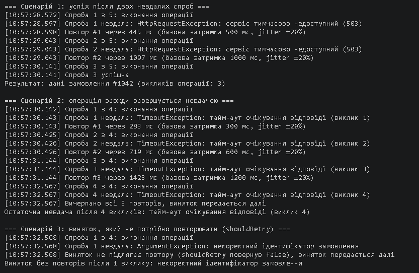

# Звіт: реалізація exponential backoff

**Проєкт:** `IndependentWork14` (.NET 8). Запуск: `dotnet run`.

## 1. Реалізація

Клас `RetryPolicy` (`RetryPolicy.cs`) містить приватні поля `_maxRetries`, `_initialDelay`, `_jitterFactor` та конструктор `RetryPolicy(int maxRetries, TimeSpan initialDelay, double jitterFactor = 0.2)` з перевіркою аргументів (`maxRetries ≥ 0`, `initialDelay ≥ 0`, `jitterFactor ∈ [0; 1]`).

Метод `T Execute<T>(Func<T> operation, Func<Exception, bool> shouldRetry = null)` узагальнений, тому підходить для будь-якої операції, що повертає значення (у демо використано `string` та `int`).

**Алгоритм:**
1. Виконати `operation()`. Якщо успішно, повернути результат.
2. У разі виняткового результату залогувати причину.
3. Якщо `shouldRetry` задано і повернув `false`, негайно передати виняток далі (повтор не має сенсу).
4. Якщо повторів уже вичерпано, передати виняток далі (`throw;` зберігає оригінальний стек викликів).
5. Інакше обчислити затримку, залогувати її, виконати `Thread.Sleep` і повторити.

**Формула затримки** (за методичкою, `retryAttempt` рахується з 0):

```
delay = initialDelay * 2^retryAttempt * (1 + random.NextDouble() * jitterFactor * 2 - jitterFactor)
```

Множник у дужках дорівнює значенню з діапазону `[1 - jitterFactor; 1 + jitterFactor]`, тобто при `jitterFactor = 0.2` затримка відхиляється від базової на ±20 %. Для випадкових чисел використано `Random.Shared` (потокобезпечний).

## 2. Демонстрація

| Сценарій | Параметри політики | Що перевіряється |
|---|---|---|
| 1. Успіх після невдач | `maxRetries = 4`, `initialDelay = 500 мс`, `jitter = 0.2`, `shouldRetry = ex is HttpRequestException` | Дві невдалі спроби, на третій успіх; повертається `string` |
| 2. Завжди невдача | `maxRetries = 3`, `initialDelay = 300 мс`, `jitter = 0.2` (за замовчуванням) | Усі 4 спроби невдалі, остаточний `TimeoutException` |
| 3. Виняток без повторів | `maxRetries = 3`, `shouldRetry` дозволяє лише `TimeoutException` і `HttpRequestException` | `ArgumentException` не повторюється, одна спроба; `T = int` |

### Очікувані діапазони затримок

Фактичні значення різні в кожному запуску через jitter, але мають потрапляти в діапазони:

| Повтор (`retryAttempt`) | Сценарій 1 (500 мс, ±20 %) | Сценарій 2 (300 мс, ±20 %) |
|---:|---|---|
| #1 (0) | 400–600 мс | 240–360 мс |
| #2 (1) | 800–1200 мс | 480–720 мс |
| #3 (2) | | 960–1440 мс |

### Вивід програми



Що має бути видно у виводі:
- **Сценарій 1:** `Спроба 1 невдала` → `Повтор #1 через ~500 мс` → `Спроба 2 невдала` → `Повтор #2 через ~1000 мс` → `Спроба 3 успішна`.
- **Сценарій 2:** чотири невдалі спроби, три повтори із затримками ~300, ~600, ~1200 мс, а потім `Вичерпано всі 3 повторів` і `Остаточна невдача після 4 викликів`.
- **Сценарій 3:** одна спроба, `Виняток не підлягає повтору`, жодних затримок.

## 3. Висновок щодо меж застосування Retry з exponential backoff

**Коли доречно:**
- Для **тимчасових (transient) збоїв**: мережеві таймаути, короткочасна недоступність сервісу (HTTP 503), блокування БД, перевантаження черги. Повторна спроба за мить, найімовірніше, вдасться.
- **Експоненційне зростання** затримки дає залежності час відновитися й не навантажує її частими запитами.
- **Jitter** розсинхронізує клієнтів. Без нього всі, хто отримав помилку одночасно, повторюють запит в один момент і створюють «ефект стада» (thundering herd) у момент, коли сервіс ще не відновився.

**Коли недоречно або небезпечно:**
- **Постійні помилки** (неправильні дані, порушення унікальності, 401/403/404): повтор не допоможе, а лише марнує час. Саме для цього призначений параметр `shouldRetry` (сценарій 3).
- **Неідемпотентні операції** (оплата, створення замовлення): повтор після невдалої відповіді може виконати дію двічі, якщо перша спроба насправді пройшла. Потрібні ключі ідемпотентності.
- **Довготривала недоступність**: Retry лише відтягує момент відмови. У такому разі краще Circuit Breaker, який припиняє виклики на певний час.
- **Критичні до затримки сценарії**: загальний час очікування зростає експоненційно (при 500 мс і 4 повторах це понад 7 с), що неприйнятно для інтерактивних запитів.
- **Каскадні повтори**: якщо повторюють кілька шарів системи одночасно, кількість запитів множиться (3 повтори на кожному з 3 шарів дають 27 запитів).

**Обмеження цієї реалізації:**
- Немає верхньої межі для затримки (`maxDelay`): при великому `maxRetries` затримка може стати надмірною.
- Використовується блокуючий `Thread.Sleep`, тому для асинхронного коду потрібна окрема версія з `await Task.Delay` і підтримкою `CancellationToken`.
- Немає загального ліміту часу на всі спроби та метрик.
- У промислових проєктах зазвичай використовують перевірену бібліотеку (наприклад, Polly), яка вирішує ці питання, але власна реалізація допомагає зрозуміти принцип роботи.