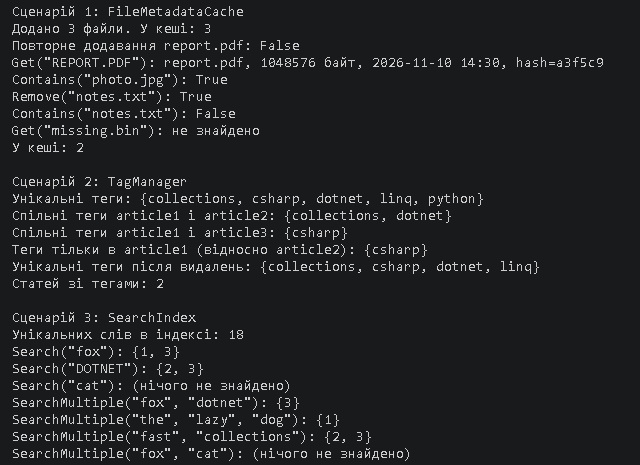

# Самостійна робота №8
**Тема:** Вивчення `Dictionary<TKey, TValue>` та `HashSet<T>` у бібліотеках .NET
**Проєкт:** `lab8-self-v1`

Звіт з аналізом open-source прикладів і порівняльною таблицею: [REPORT.md](REPORT.md).

## Структура

| Файл | Призначення |
|---|---|
| `FileMetadataCache.cs` | Сценарій 1: кеш метаданих (`Dictionary<string, FileMetadata>`) |
| `TagManager.cs` | Сценарій 2: теги статей (`Dictionary<string, HashSet<string>>`, `UnionWith`/`IntersectWith`/`ExceptWith`) |
| `SearchIndex.cs` | Сценарій 3: інвертований індекс (`Dictionary<string, HashSet<int>>`) |
| `Program.cs` | Демонстрація всіх трьох сценаріїв |

## Приклад виводу програми

