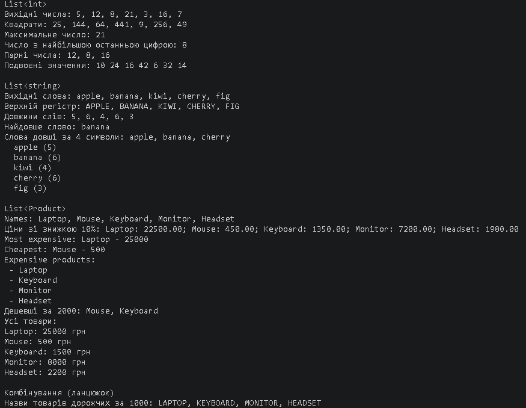

# Самостійна робота №9
**Тема:** Делегати й лямбда-вирази: власні утиліти для колекцій
**Проєкт:** `lab9-self-v1`

## Структура проєкту

| Файл | Призначення |
|---|---|
| `CollectionUtils.cs` | Статичний клас з методами `Map`, `MaxBy`, `Filter`, `ForEach` |
| `Product.cs` | Клас `Product` (`Name`, `Price`) для демонстрації |
| `Program.cs` | Демонстрація на `List<int>`, `List<string>`, `List<Product>` |

Запуск: `dotnet run` у папці проєкту (.NET 8).

## Реалізовані методи

| Метод | Делегат | Аналог LINQ |
|---|---|---|
| `Map<TSource, TResult>` | `Func<TSource, TResult>` | `Select` |
| `MaxBy<T, TKey>` (де `TKey : IComparable<TKey>`) | `Func<T, TKey>` | `MaxBy` |
| `Filter<T>` | `Predicate<T>` | `Where` |
| `ForEach<T>` | `Action<T>` | `List<T>.ForEach` (для `IEnumerable<T>` у LINQ немає) |

## Приклад виводу програми


## Звіт

### 1. Чому делегати корисні для створення таких утиліт?

Делегат — це тип, який зберігає посилання на метод. Завдяки цьому логіку можна передавати в інший метод як параметр. Усі чотири утиліти містять лише «каркас» дії (обхід колекції), а те, що саме робити з елементом, вирішує делегат, який передає викликаючий код:

- **Відокремлення алгоритму від поведінки.** Цикл `foreach` написано один раз у `Map`, `Filter` тощо. Змінюється лише делегат: перетворення, умова чи дія.
- **Повторне використання коду.** Без делегатів довелося б писати окремий метод для кожного випадку: `GetNames`, `GetPrices`, `FilterExpensive`, `FilterEven` і т. д.
- **Узагальненість.** Через `Func<TSource, TResult>`, `Predicate<T>` та `Action<T>` ті самі методи працюють з `int`, `string`, `Product` та будь-яким іншим типом.
- **Типобезпека.** Компілятор перевіряє, що сигнатура делегата збігається з очікуваною. Наприклад, `MaxBy` вимагає від ключа реалізації `IComparable<TKey>`.
- **Гнучкість.** Поведінку визначає викликаючий код, і її можна змінювати без правок самої утиліти.

### 2. Як лямбда-вирази спрощують виклик цих методів?

Без лямбд для кожного виклику треба було б оголошувати окремий іменований метод:

```csharp
static bool IsExpensive(Product p) => p.Price > 1000;
var expensive = CollectionUtils.Filter(products, IsExpensive);
```

З лямбда-виразом умова записується прямо в місці виклику, в один рядок:

```csharp
var expensive = CollectionUtils.Filter(products, p => p.Price > 1000);
```

Переваги лямбд:

- **Коротший запис.** Не потрібні окремий метод, ім'я та явні типи параметрів: їх виводить компілятор з типу колекції.
- **Логіка поруч із викликом.** Код легше читати, бо не треба шукати визначення методу деінде.
- **Замикання.** Лямбда може використовувати локальні змінні з навколишнього коду, наприклад `p => p.Price > minPrice`.
- **Зручні ланцюжки викликів.** У програмі видно приклад: `Map(Filter(products, p => p.Price > 1000), p => p.Name.ToUpper())`.
- **Той самий метод з різною поведінкою.** `MaxBy(products, p => p.Price)` шукає найдорожчий товар, а `MaxBy(products, p => -p.Price)` — найдешевший.

### 3. Порівняння власних методів із вбудованими LINQ-операторами

| Власний метод | LINQ | Спільне | Відмінності |
|---|---|---|---|
| `Map` | `Select` | Приймає `Func<TSource, TResult>`, перетворює кожен елемент | Мій `Map` виконується **негайно** і повертає готовий `List<TResult>`. `Select` працює **відкладено** (lazy) через `yield return`. У LINQ є ще перевантаження з індексом елемента. |
| `MaxBy` | `Enumerable.MaxBy` (.NET 6+) | Знаходить елемент за максимальним ключем | Мій метод для порожньої колекції повертає `default(T)`, а LINQ `MaxBy` для типів, що допускають `null`, повертає `null`, а для типів-значень кидає `InvalidOperationException`. Мій метод обмежений `IComparable<TKey>`, а LINQ дозволяє передати власний `IComparer<TKey>`. |
| `Filter` | `Where` | Приймає предикат, повертає підмножину елементів | Мій `Filter` негайний і використовує `Predicate<T>`, а `Where` — відкладений і використовує `Func<T, bool>`. Для лямбд це не відрізняється. |
| `ForEach` | немає для `IEnumerable<T>` | Виконує `Action<T>` для кожного елемента | LINQ навмисно його не містить, бо LINQ-оператори мають бути «чистими» (без побічних ефектів). Є лише `List<T>.ForEach`. |

**Висновки:**

- Власні методи реалізують ту саму ідею, що й LINQ, тому їх було легко написати. Це допомагає зрозуміти, як LINQ працює «під капотом».
- Вбудований LINQ кращий для реальних проєктів: він відкладено виконується, має більше перевантажень, оптимізований і протестований.
- Відкладене виконання дає перевагу в продуктивності. Наприклад, `Where(...).First()` не обробляє всю колекцію, а мій `Filter` спочатку проходить усі елементи.
- Реалізація власних утиліт добре показує, що делегати та лямбда-вирази — основа LINQ і подієвої моделі в C#.