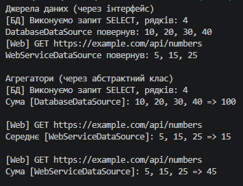

# Лабораторна робота №10 — Абстрактні класи та інтерфейси (Варіант 18)

## Про проєкт

Реалізовано інтерфейс `IDataSource<T>` та абстрактний клас `DataAggregator`. Агрегатори отримують дані з джерел через інтерфейс і обчислюють результат.

## Реалізація

- `IDataSource<T>` — метод `IEnumerable<T> GetData()`.
- `DatabaseDataSource`, `WebServiceDataSource` — реалізації `IDataSource<int>` (імітація БД і веб-сервісу).
- `DataAggregator` — абстрактні `FetchData()` і `Aggregate()`, конкретний `DisplayAggregatedData()`.
- `SumAggregator` — обчислює суму.
- `AverageAggregator` — обчислює середнє, обробляє порожній набір.

## Демонстрація в Main

1. Список `List<IDataSource<int>>`: виклик `GetData()` для кожного джерела.
2. Список `List<DataAggregator>`: для кожного викликано `FetchData()`, `Aggregate()`, `DisplayAggregatedData()`.

## Приклад результату

