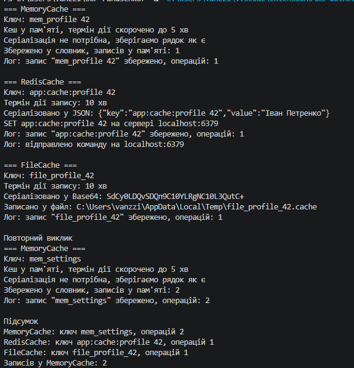

# Лабораторна робота №11 — Template Method (Варіант 18)

## Про проєкт

Реалізовано патерн Template Method на прикладі керування кешем: абстрактний клас `CacheManager` та три похідні реалізації `MemoryCache`, `RedisCache`, `FileCache`.

## Реалізація

Шаблонний метод `Cache(string name, string data)` викликає кроки в порядку: `GenerateKey` → `CheckExpiration` → `Serialize` → `Store` → `LogOperation`.

- `GenerateKey`, `Serialize`, `Store` — `abstract`, обов'язкові для реалізації.
- `CheckExpiration`, `LogOperation` — `virtual` з базовою реалізацією.
- `MemoryCache` — зберігає записи в словнику, скорочує термін дії до 5 хв.
- `RedisCache` — серіалізує в JSON, імітує команду `SET`, доповнює лог.
- `FileCache` — серіалізує в Base64 і записує у файл у тимчасовій папці.

## Демонстрація в Main

1. Створено список `List<CacheManager>` з об'єктами трьох класів.
2. Для кожного викликано шаблонний метод `Cache()`.
3. Виведено підсумок: ключі та кількість операцій.

## Приклад результату

