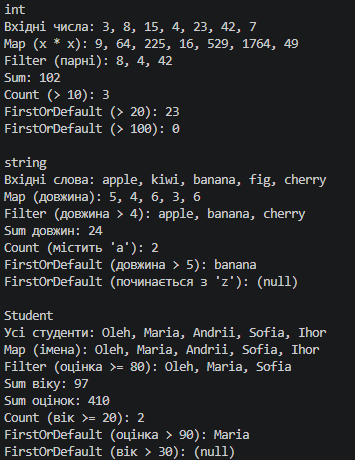

# Лабораторна робота №12 — Generic-методи, Func/Action/Predicate (Варіант 18)

## Про проєкт

Реалізовано клас `FunctionalUtils` з generic-методами для роботи зі списками та делегатами.

## Реалізовані методи (варіант 18)

- `Map<T, TResult>` — перетворення елементів через `Func<T, TResult>`.
- `Filter<T>` — відбір елементів через `Func<T, bool>`.
- `Sum<T, TNum>` — сума числового поля, обмеження `where TNum : INumber<TNum>`.
- `Count<T>` — підрахунок елементів за умовою `Predicate<T>`.
- `FirstOrDefault<T>` — перший елемент за умовою або `default(T)`.

## Демонстрація в Main

Кожен метод викликано для трьох типів даних: `int`, `string` і власного класу `Student`, умови передано лямбда-виразами.

## Приклад результату

