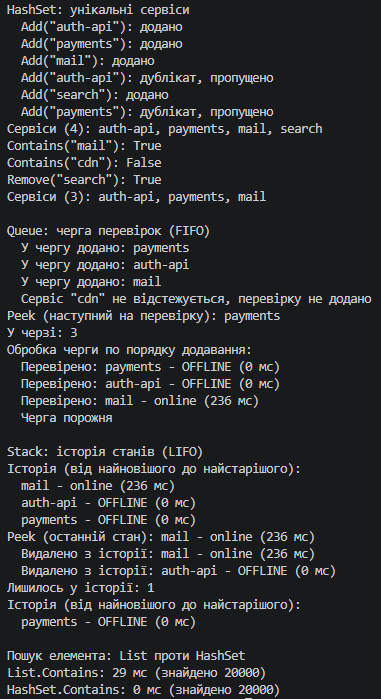

# Лабораторна робота №14 — HashSet/Queue/Stack (Варіант 18)

## Про проєкт

Система моніторингу сервісів, що демонструє три спеціалізовані колекції.

## Що виконує кожна колекція

- `HashSet<string>` — унікальні сервіси для моніторингу (дублікати відсіюються, швидка перевірка наявності).
- `Queue<string>` — черга перевірок статусу (FIFO, перевірки виконуються в порядку додавання).
- `Stack<ServiceStatus>` — історія станів сервісів (LIFO, `Peek` показує останній стан, `Pop` забирає його).

## Демонстрація в Main

1. Додавання сервісів у `HashSet` з дублікатами, `Contains`, `Remove`.
2. Постановка перевірок у чергу, `Peek`, обробка через `Dequeue`.
3. Перегляд історії (`Peek`, `Pop`) і показ того, що порядок зворотний до черги.
4. Порівняння швидкості `List.Contains` і `HashSet.Contains`.

## Приклад результату

