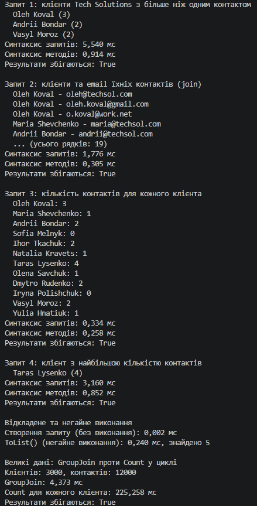

# Лабораторна робота №15 — LINQ: фільтри, join, агрегації. Продуктивність (Варіант 18)

## Про проєкт

Сценарій: клієнти та їхні контакти. У лабораторній роботі виконано чотири LINQ-запити в обох синтаксисах (запитів і методів), для кожного виміряно час через `Stopwatch` і перевірено, що результати збігаються.

## Сутності та тестові дані

- `Client (Id, Name, Company)` — 12 клієнтів із п'яти компаній.
- `Contact (Id, Email, Phone, ClientId)` — 19 контактів. У двох клієнтів контактів немає, щоб було видно різницю між `Join` і `GroupJoin`.

## Запити

1. Клієнти компанії "Tech Solutions" з більше ніж одним контактом (`join ... into` + `where` / `Where` + `Count`).
2. Об'єднання клієнтів з контактами: ім'я клієнта та email (`join` / `Join`).
3. Кількість контактів для кожного клієнта (`join ... into` / `GroupJoin`).
4. Клієнт з найбільшою кількістю контактів (`orderby descending` / `MaxBy`).

## Результати вимірювання часу

| Запит | Синтаксис запитів | Синтаксис методів |
|-------|-------------------|-------------------|
| 1. Фільтрація | 5,540 мс | 0,914 мс |
| 2. Join | 1,776 мс | 0,305 мс |
| 3. Агрегація (кількість) | 0,334 мс | 0,258 мс |
| 4. Максимум | 3,160 мс | 0,852 мс |

Відкладене та негайне виконання: створення запиту 0,002 мс, `ToList()` 0,240 мс.

Великі дані (3000 клієнтів, 12000 контактів):

| Підхід | Час |
|--------|-----|
| `GroupJoin` | 4,373 мс |
| `Count` для кожного клієнта | 225,258 мс |

## Висновки про продуктивність

1. Обидва синтаксиси компілюються в однакові виклики методів, тому результати збігаються, а різниця в часі на малих даних випадкова.
2. Перший запит у програмі виконується найдовше через JIT-компіляцію під час першого запуску, а не через сам LINQ.
3. Найдорожчою операцією виявився `Count` усередині циклу: для кожного клієнта він перебирає всі контакти (n × m порівнянь). На великих даних це приблизно у 50 разів повільніше за `GroupJoin`, який будує хеш-таблицю за ключем (n + m операцій).
4. Запит без `ToList()` майже не займає часу (0,002 мс), увесь час витрачається під час виконання.
5. Для пошуку одного максимуму `MaxBy` ефективніший за `orderby descending`: він робить один прохід, а сортування обробляє всю колекцію.
6. `Join` пропускає клієнтів без контактів, а `GroupJoin` зберігає їх із порожньою групою, тому для підрахунку (запит 3) використано саме `GroupJoin`.

## Приклад результату

