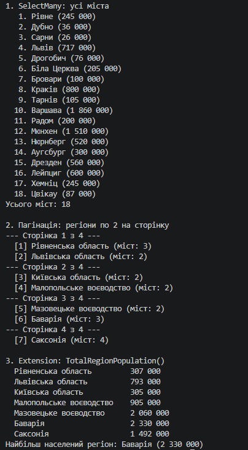

# Лабораторна робота №16 — LINQ: SelectMany, пагінація й custom extensions (Варіант 18)

## Про проєкт

Консольний застосунок на C# (.NET), що працює зі сценарієм «Країни та їхні регіони з містами». Дані вкладені: `Country` → `Region` → `City`.

## Структура проєкту

```
lab16v18/
├── Program.cs                  — Main і демонстрація трьох запитів
├── Models/
│   ├── Country.cs              — Country (Id, Name, List<Region>)
│   ├── Region.cs               — Region (Id, Name, List<City>)
│   └── City.cs                 — City (Id, Name, Population)
├── Extensions/
│   └── RegionExtensions.cs     — метод розширення TotalRegionPopulation()
└── Data/
    └── TestData.cs             — тестові дані (3 країни, 7 регіонів, 18 міст)
```

## Реалізовані запити (варіант 18)

- **SelectMany** — усі міста всіх регіонів усіх країн в одному списку: `countries.SelectMany(c => c.Regions).SelectMany(r => r.Cities)`.
- **Пагінація** — усі регіони по 2 на сторінку через `Skip((page - 1) * pageSize).Take(pageSize)`.
- **Custom Extension** — `TotalRegionPopulation(this Region region)` обчислює загальне населення регіону як суму населення його міст.

## Демонстрація в Main

Кожен запит винесено в окремий метод (`ShowAllCities`, `ShowRegionPages`, `ShowRegionPopulations`). Пагінація виводить усі 4 сторінки поспіль, а метод розширення викликається для кожного регіону й для пошуку найбільш населеного.


## Приклад результату

