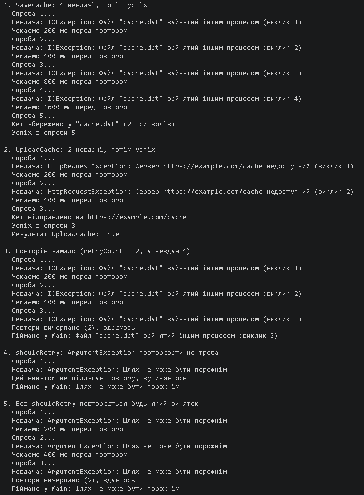

# Лабораторна робота №17 — Обробка IO/мережевих помилок та Retry (Варіант 18)

## Про проєкт

Сценарій: збереження кешу. Реалізовано `FileProcessor`, `NetworkClient` і узагальнений `RetryHelper` з експоненційною затримкою.

## Реалізація

- `FileProcessor.SaveCache(path, cacheData)` — імітує `IOException` перші 4 рази.
- `NetworkClient.UploadCache(url, cacheData)` — імітує `HttpRequestException` перші 2 рази.
- `RetryHelper.ExecuteWithRetry<T>` — повторює операцію, логує кожну спробу, затримка `initialDelay * 2^attempt`.
- `shouldRetry` — повторює лише `IOException` та `HttpRequestException`.

## Демонстрація в Main

1. `SaveCache`: 4 невдачі, успіх з 5-ї спроби.
2. `UploadCache`: 2 невдачі, успіх з 3-ї спроби.
3. Недостатня кількість повторів: виняток передається далі.
4. `shouldRetry`: `ArgumentException` не повторюється.
5. Без `shouldRetry` повторюється будь-який виняток.

## Висновок

Експоненційна затримка подвоюється після кожної невдачі (200, 400, 800, 1600 мс), тому сервісу дається все більше часу на відновлення. Це зменшує навантаження порівняно з повторами через однакові інтервали.

## Приклад результату

