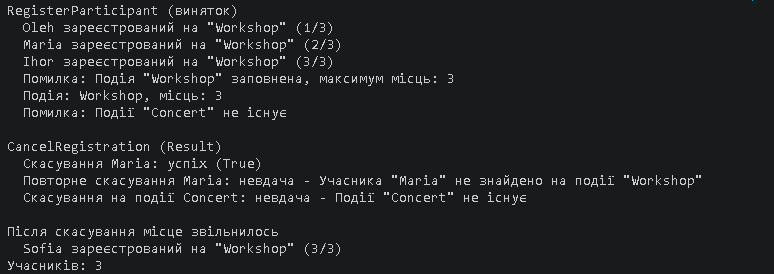

# Лабораторна робота №18 — Власні винятки та патерн Result (Варіант 18)

## Про проєкт

Сценарій: управління подіями. Реалізовано власний виняток, узагальнений `Result<T>` і сервіс `EventManagementService`.

## Реалізація

- `EventCapacityExceededException (EventName, MaxCapacity)` — виняток для переповненої події.
- `Result<T>` — `IsSuccess`, `Value`, `Error`, приватний конструктор, `Success`, `Failure(string)`, `Failure(Exception)`.
- `EventManagementService`:
  - `RegisterParticipant` — кидає виняток, якщо місць немає;
  - `CancelRegistration` — повертає `Result<bool>`, якщо учасника не знайдено;
  - `CreateEvent` — допоміжний метод.

## Висновок

У лабораторній роботі реалізовано власний виняток `EventCapacityExceededException`, узагальнений клас `Result<T>` та сервіс `EventManagementService`. Для методу `RegisterParticipant` обрано виняток, бо спроба зареєструватись на заповнену подію порушує правило системи, і цю помилку не можна випадково проігнорувати: виняток також несе додаткові дані (`EventName`, `MaxCapacity`). Для методу `CancelRegistration` обрано `Result<T>`, бо відсутність учасника або події є очікуваною ситуацією (наприклад, повторне скасування), і її зручніше обробляти через `IsSuccess` та `Error` без `try-catch`, що також дешевше за викидання винятку. Отже, виняток доцільний для порушень правил і нештатних ситуацій, а `Result<T>` для передбачуваних невдач у звичайному ході роботи програми.

## Приклад результату

