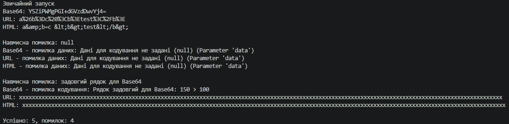

# Лабораторна робота №9 — Поліморфні сервіси: Encoder (Варіант 18)

## Про проєкт

Реалізовано поліморфну систему кодування даних: абстрактний клас `Encoder` і три похідні реалізації `Base64Encoder`, `URLEncoder`, `HTMLEncoder`.

## Реалізація

- `Encoder` — абстрактний метод `Encode(string data)` і спільна перевірка `CheckData` (дані не `null`).
- `Base64Encoder` — кодує в Base64, має обмеження довжини `MaxLength`.
- `URLEncoder` — екранує рядок для URL.
- `HTMLEncoder` — екранує спецсимволи HTML.
- `EncodingException` — власний виняток.
- `EncoderService` — метод `EncodeAll(List<Encoder>, string)` перебирає список і обробляє винятки.

## Демонстрація в Main

1. Список `List<Encoder>` з трьома кодувальниками.
2. Звичайний запуск.
3. Навмисні помилки: `null` і задовгий рядок для Base64.
4. Підсумок: кількість успішних операцій і помилок.

## Приклад результату

